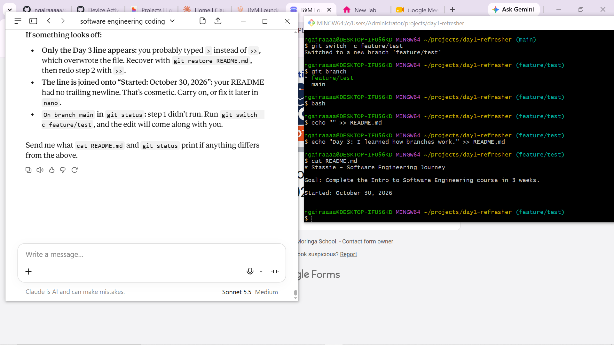

# Day 1 Refresher

A practice repository for learning Git, GitHub and the terminal as part of my software engineering course.

## What's inside
- `README.md`: this file
- `prompts.md`: prompt engineering practice
- `progress.md`: my daily log

## Getting started
1. Clone the repository:

```bash
git clone https://github.com/ngairaaaaa/day1-refresher.git
```

2. Move into the folder:

```bash
cd day1-refresher
```

## Screenshot


## License
This project is licensed under the MIT License. See the [LICENSE](LICENSE) file for details.
